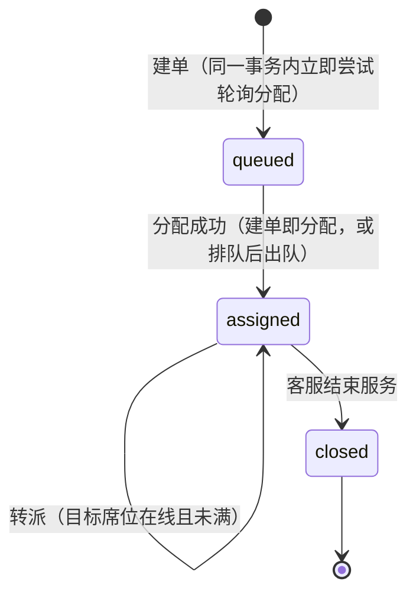
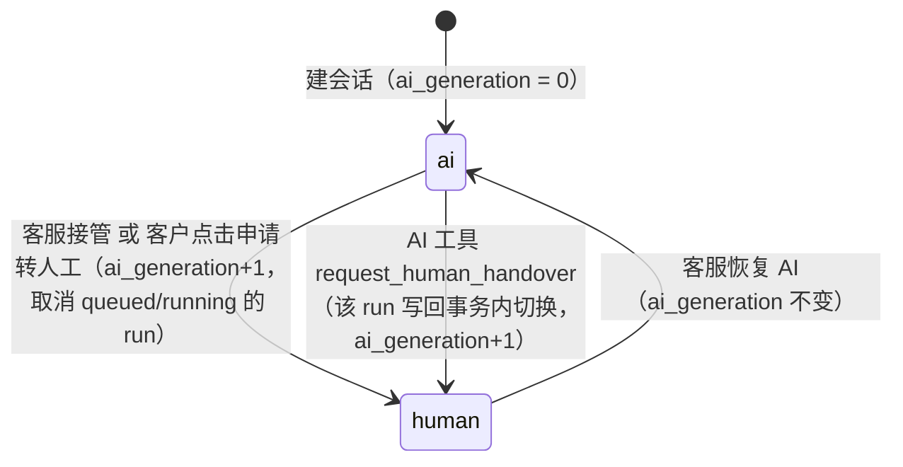
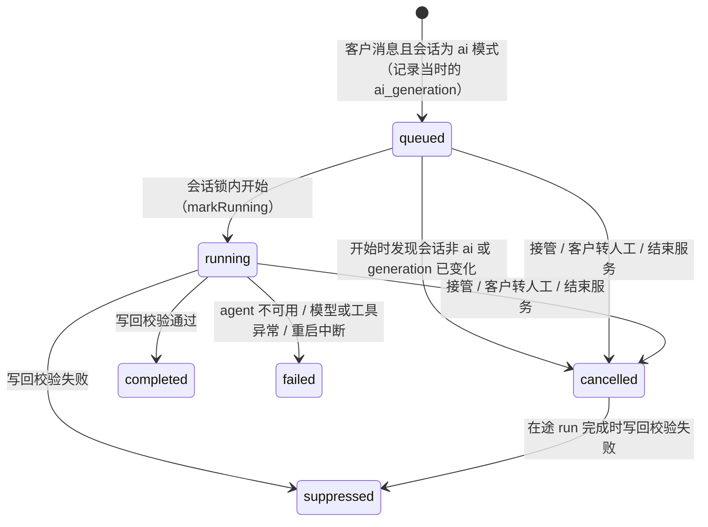
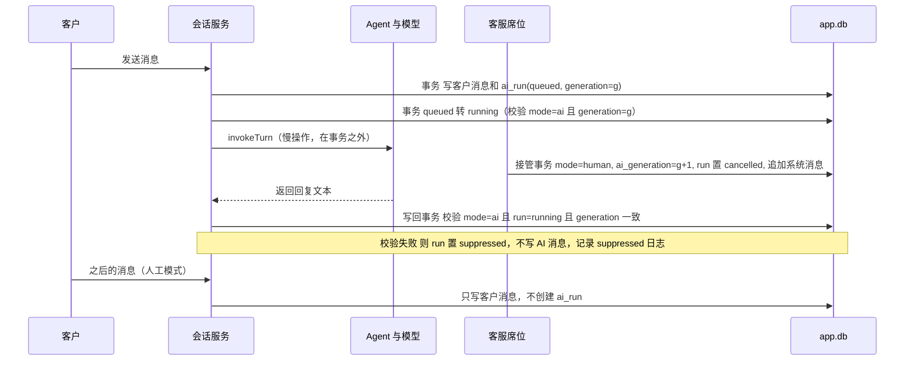
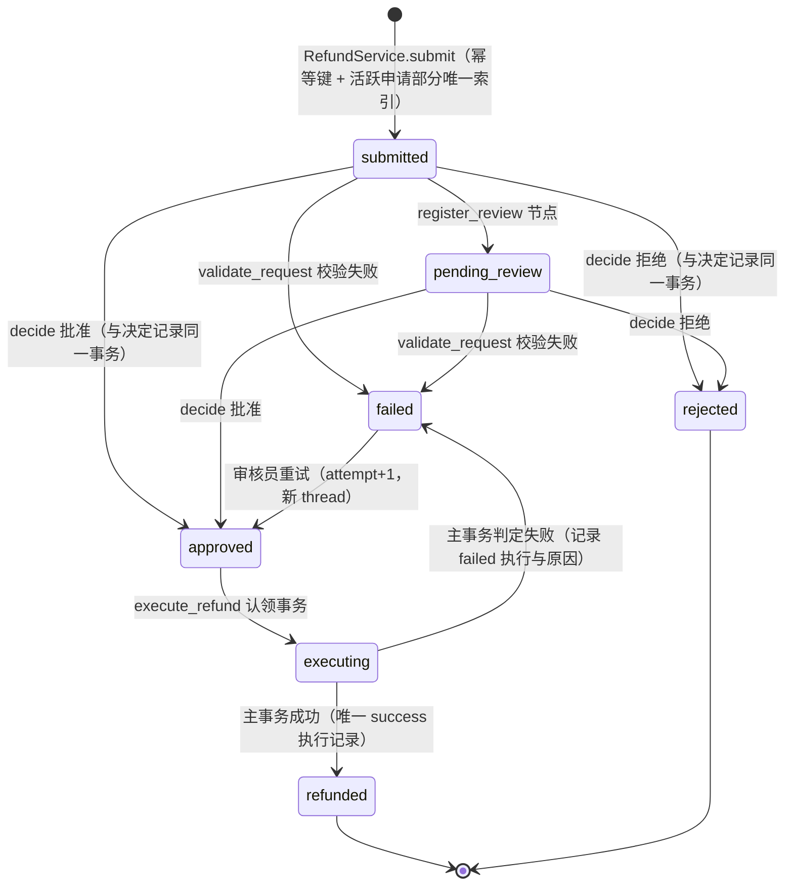
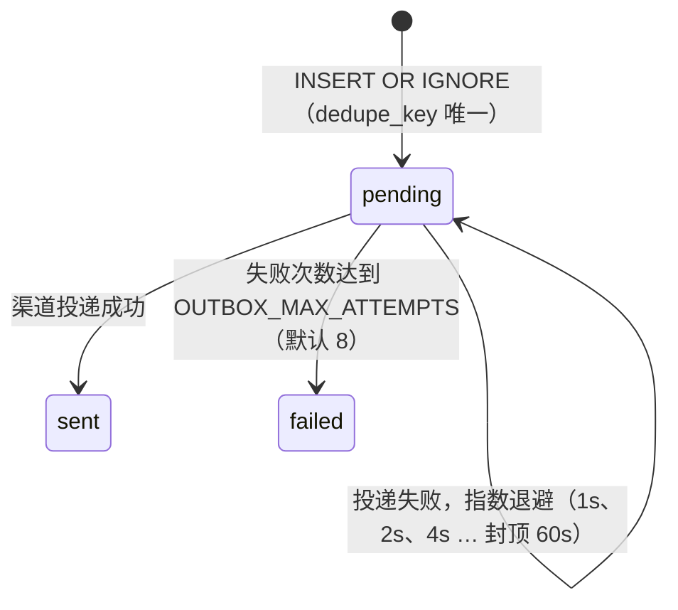
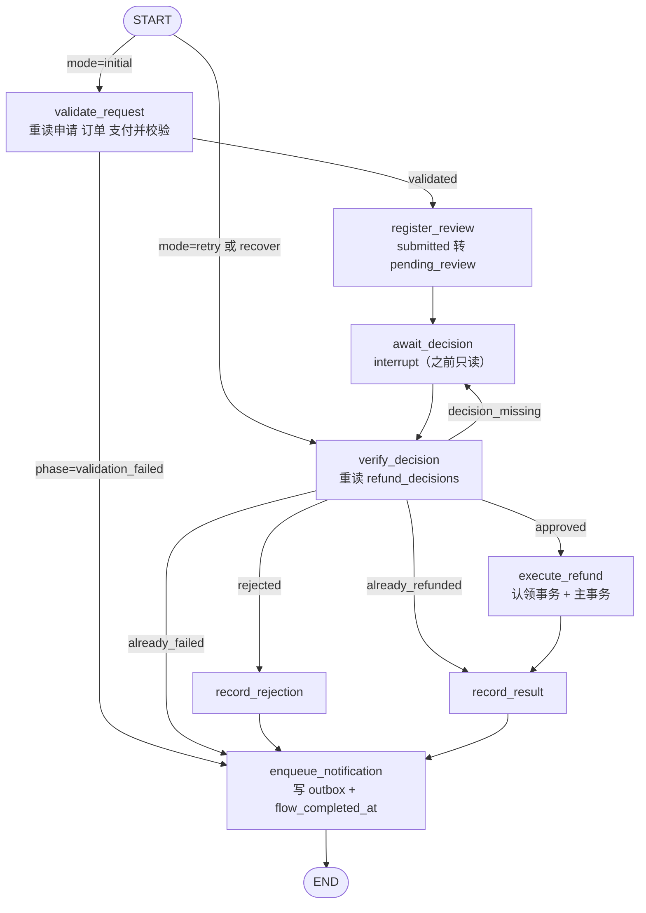
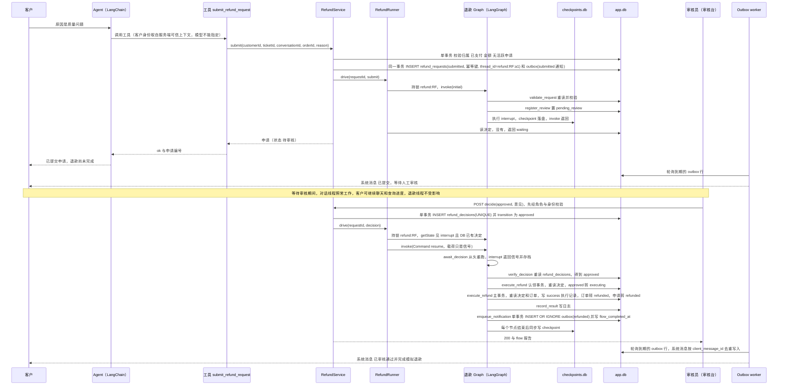

# 状态说明（定稿）

本文描述系统里所有“会变化的状态”：它们存在哪里、谁能改、允许怎样流转、崩溃或重启后如何恢复。内容以代码为准，对应文件：

- `server/services/{tickets,assignment,conversation,handover,refunds,outbox}.ts`
- `server/graphs/refund/{state,graph,nodes,runner,crash}.ts`
- `server/db/migrations/0001_init.sql`

更细的 SQL、签名与契约见 `docs/SPEC.md` §E（领域状态机）、§H（退款 Graph）、§I（Outbox）；设计约束见 `docs/ARCHITECTURE.md`。

---

## 0. 状态分表原则

需求要求“会话接待状态、工单状态和退款状态分别保存”。本系统按下表拆分，彼此不互相替代、不互相推导：

| 状态 | 位置 | 取值 | 写入者 | 说明 |
| - | - | - | - | - |
| 工单状态 | `tickets.status`（`app.db`） | `queued` / `assigned` / `closed` | 分配服务、工单服务 | 面向客服席位的服务生命周期 |
| 会话接待状态 | `conversations.handling_mode` + `ai_generation`（`app.db`） | `ai` / `human`；`ai_generation` 整数 | 接管服务、AI 写回事务、结单 | 决定“此刻谁回复客户”，`ai_generation` 用来作废在途 AI 回复 |
| AI run 状态 | `ai_runs.status`（`app.db`） | `queued` / `running` / `completed` / `suppressed` / `cancelled` / `failed` | 会话服务 | 一次 AI 回复尝试的生命周期 |
| 退款申请状态 | `refund_requests.status`（`app.db`） | `submitted` / `pending_review` / `approved` / `rejected` / `executing` / `refunded` / `failed` | 退款服务、退款 Graph 节点 | 退款的业务事实 |
| 审批决定 | `refund_decisions`（`app.db`） | `approved` / `rejected`，`refund_request_id` 唯一 | 退款服务 `decide` | **权威审批记录**，执行节点只信它 |
| 退款执行记录 | `refund_executions`（`app.db`） | `success` / `failed`，`(request, attempt)` 唯一 | `execute_refund` 节点 | 每申请至多一条 success |
| 通知投递状态 | `outbox.status`（`app.db`） | `pending` / `sent` / `failed` | 退款服务、Graph 的 `enqueue_notification`、outbox worker | 持久化发送队列 |
| 退款流程是否走完 | `refund_requests.flow_completed_at`（`app.db`） | NULL / 时间 | `enqueue_notification` 节点（重试时重置为 NULL） | 启动恢复据此找出未走完的流程 |
| Graph 执行进度 | `checkpoints.db`（`SqliteSaver`） | LangGraph checkpoint | LangGraph | 只保存“执行到哪一步”，**不是业务权限或事务的依据** |
| 对话 Agent 上下文 | `checkpoints.db`，`thread_id = conv_<uuid>` | LangChain `createAgent` 的消息线程 | LangChain | 每张工单一个线程，由服务端按 conversation 查出，永不从客户端接收 |

两个独立的 LangGraph 线程族：

- 对话线程：`conv_<uuid>`（每个会话一个，永不复用）。
- 退款线程：`refund:<requestId>:a<attempt>`（每个申请每次尝试一个；审核员重试时 attempt+1，换新线程）。

两者都存放在 `data/checkpoints.db`，与业务库 `data/app.db` 分文件，且两族线程互不引用。客户在等待审核期间继续聊天，只会推进对话线程，不会触碰退款线程。

---

## 1. 工单（`tickets.status`）



要点：

- 建单时先插入 `queued`（`seat_id` 为空），随后在同一事务里调用 `assignInTx`：轮询游标 `assignment_state.rr_cursor` 从上次席位的下一个开始，跳过 `online=0` 或已分配工单数达到 `capacity`（默认 2）的席位；找不到可用席位则保持 `queued`。
- 出队 `drainQueue()` 按 `created_at` 先进先出，触发时机：席位上线（`POST /agent/me/status`）、工单结束、工单转派（原席位释放容量）。
- 席位下线不会回收已分配的工单。
- `queued` 状态下 AI 仍然正常回复（接待状态与工单状态互相独立）。
- 数据库约束：`queued` 必须 `seat_id IS NULL`，`assigned` 必须 `seat_id IS NOT NULL`。
- 结束工单（同一事务）：置 `closed`、`ai_generation + 1`、取消排队/进行中的 AI run、追加系统消息“本次服务已结束，如有新问题请发起新的咨询。”；事务后触发出队。客户若显式向已结束的工单发消息会得到 409 `TICKET_CLOSED`（前端禁用输入框，提示点“新建咨询”）；不指定工单时，系统只会沿用最近一张未结束的工单，没有则新建。
- 说明：仓储层 `tickets.close` 允许 `queued → closed`，但服务层 `close` 先经 `requireSeatTicket` 校验 `seat_id = 当前席位`，而排队中的工单没有席位，所以 **经 API 无法结束排队中的工单**（会得到 403），只能先出队再结束。

---

## 2. 会话接待状态（`conversations.handling_mode`）



| 触发 | 实现 | 对在途 AI 的影响 |
| - | - | - |
| 客服 `takeover` | 条件更新 `WHERE handling_mode='ai'`；已是 `human` 则幂等返回；`aiRuns.cancelActive`；追加系统消息“人工客服 X 已接入，AI 助手暂停自动回复。” | 在途 run 被置 `cancelled`，写回时 `suppressed` |
| 客户 `handover`（按钮） | 同上，另写 `tickets.handover_requested=1` 及原因；系统消息“已为您申请人工客服，请稍候…” | 同上 |
| AI 工具 `request_human_handover` | 只给当前 run 打 `handover_requested=1` 并标记工单，**不立即切换**（否则本 run 的回复会被自己抑制）；run 写回成功后在同一事务里切到 `human`，追加系统消息“已为您转接人工客服，请稍候。” | 本 run 的回复正常发出，之后切换 |
| 客服 `resume-ai` | 条件更新 `WHERE handling_mode='human'`；系统消息“AI 助手已恢复服务。”；**不补答**接管期间的客户消息 | 下一条客户消息才触发 AI |
| 工单结束 | 不改 `handling_mode`，但 `ai_generation + 1` | 在途 run 被作废 |

`human` 模式下客户消息照常入库但不创建 `ai_run`；客服回复必须先接管（未接管回复得到 409 `NOT_TAKEN_OVER`）。客户按钮转人工时，即使工单还在排队（没有席位），接待状态也会立刻变为 `human`，AI 暂停。

---

## 3. AI run（`ai_runs.status`）与 generation 抑制



写回校验在同一个事务里完成，必须同时满足：

```
conversations.handling_mode = 'ai'
AND ai_runs.status = 'running'
AND ai_runs.generation = conversations.ai_generation
AND tickets.status != 'closed'
```

- 通过：插入一条 `sender_type='ai'` 的消息（带来源），`ai_runs` 置 `completed`（每个 run 至多写回一条，`ux_messages_ai_run` 唯一索引兜底）；若 run 标记了 `handover_requested`，再切到 `human` 并追加系统消息。
- 不通过：run 置 `suppressed`，**不插入消息**，并写 `execution_logs(scope='conversation', node='ai_run', event='suppressed')`，detail 含 run 与会话各自的 generation。客服工作台对应显示“有 N 条 AI 回复因人工接管已被拦截”。
- 模型/工具异常：run 置 `failed`，若会话仍是同一代 `ai` 模式，追加系统消息“抱歉，智能助手暂时无法回复，请稍后再试或申请转人工。”
- 同一会话的 AI run 经 `conv:<conversationId>` 锁串行；不同会话并行。接管是同步事务，**不等待**该锁，因此接管可以发生在 AI 调用进行中；是否能写回由上面的写回事务裁决。

接管与 AI 写回的竞态：



---

## 4. 退款申请（`refund_requests.status`）



关键事实：

- **批准/拒绝的状态迁移发生在 `RefundService.decide` 的事务里**（插入 `refund_decisions` 与 `transition → approved/rejected` 同事务），不是等 Graph 恢复后才改。`verify_decision` / `record_rejection` 中的同类转换只是崩溃补偿（正常情况下是 no-op）。
- 因此存在“决定已落库、Graph 尚未恢复”的合法中间态：`approved`/`rejected` 且 checkpoint 仍停在 `await_decision` 的 interrupt。启动恢复据此续跑。
- `failed` 有两种来源：校验失败（无决定，不可重试，客户重新发起即可）；执行失败（决定为 approved，可由审核员 `retry`）。重试前置条件：`status='failed'` 且存在 `approved` 决定，否则 409 `NOT_RETRYABLE`；重试时同事务 `status='approved'`、`attempt+1`、`thread_id=refund:<id>:a<attempt>`、`flow_completed_at=NULL`，若该订单已有新的活跃申请则 409 `CONFLICT`。
- 活跃申请部分唯一索引 `ux_refund_active_per_order`：同一订单在 `status NOT IN ('rejected','failed')` 下只能有一条申请；重复提交返回已有申请（`existing: true`）。
- 金额一律为最小货币单位整数（分）；申请金额必须等于订单金额（第一阶段仅整单模拟退款）。
- 终态：`refunded`、`rejected`；`failed` 对流程而言是终态（通知后 `flow_completed_at` 置位），但可由审核员重新激活。

---

## 5. Outbox（`outbox.status`）



- 入队只有两处：`RefundService.submit`（`refund_submitted`，随申请同事务）与 Graph 节点 `enqueue_notification`（`refund_refunded` / `refund_rejected` / `refund_failed`）。
- 去重键：`refund:<requestId>:<status>:a<attempt>`（`submitted` 恒为 `a1`）。同键重复入队被唯一约束吸收，所以节点重跑不会产生第二条通知。
- 投递幂等：Web 渠道把通知写成系统消息，`client_message_id = 'o:' + dedupe_key`，`UNIQUE(conversation_id, client_message_id)` 保证“投递成功但 `markSent` 前崩溃”重放也只有一条消息。
- worker 每 `OUTBOX_POLL_MS`（默认 1000ms）轮询到期的 `pending` 行，单实例串行 tick。`failed` 为终态，不再自动重试，审核台“通知（outbox）”表可见。
- **隔离**：`server/services/outbox.ts` 只依赖仓储与渠道注册表，不 import 退款服务或 Graph。因此通知重试在结构上不可能触发再次退款。
- 微信、飞书渠道目前是适配器桩（`server/channels/{wechat,feishu}.ts` 抛 `ChannelNotImplementedError`），当前所有会话都建在 `web` 渠道上；若将来有会话挂到未接入的渠道，其通知会按上面的失败重试规则，最终落入 `failed`。

---

## 6. 退款 LangGraph（`server/graphs/refund/`）

### 6.1 节点与边



路由完全由 `graph.ts` 中的条件边决定，依据是节点写入的 `phase`，而 `phase` 来自对数据库的重读：

| 起点 | 条件 | 去向 |
| - | - | - |
| START | `mode = initial` | `validate_request` |
| START | `mode = retry`（attempt>1 的新线程）或 `recover` | `verify_decision`（跳过校验与等待） |
| `validate_request` | `phase = validation_failed` | `enqueue_notification`（状态已是 `failed`） |
| `validate_request` | 其他 | `register_review` |
| `verify_decision` | `approved` | `execute_refund` |
| `verify_decision` | `rejected` | `record_rejection` |
| `verify_decision` | `already_refunded` | `record_result` |
| `verify_decision` | `already_failed` | `enqueue_notification` |
| `verify_decision` | `decision_missing` 或任何意外值 | `await_decision`（再次中断） |

对应需求的七个步骤：校验申请=`validate_request`；登记审批=`register_review`；等待人工=`await_decision`；校验决定=`verify_decision`；执行模拟退款=`execute_refund`；记录结果=`record_result` / `record_rejection`；通知客户=`enqueue_notification`（只写 outbox，由 worker 投递）。

### 6.2 Graph 状态与线程

`RefundFlowState`（`state.ts`）：`requestId`、`attempt`、`mode`（`initial|retry|recover`）、`phase`、`decisionId?`、`executionId?`、`outcome`（`none|refunded|rejected|failed`）、`failureReason?`、`lastSignal?`。

- 状态里**没有** `approved:boolean` 之类的审批结论；`decisionId`、`lastSignal` 仅供审计展示。
- 所有调用使用 `{ configurable: { thread_id }, durability: "sync" }`，每个节点结束后同步写 checkpoint。
- 对同一申请的所有 `invoke` / `getState` 都在 `refund:<requestId>` 锁内串行。
- Runner 在“空”的 AsyncLocalStorage 上下文中调用 Graph：退款 Graph 可能从 Agent 的工具调用里被同步驱动，不隔离的话 LangGraph 会把它当成外层 Agent 的子图（interrupt 会变成异常向上抛，checkpoint 也不会写进退款线程）。

### 6.3 节点的幂等依据

恢复可能让节点整体重跑，因此每个节点都按“重跑也安全”编写；`instrument` 在每个节点前后各有一个崩溃注入点（`before:<node>` / `after:<node>`）。`after:` 崩溃意味着节点的数据库副作用已提交而 checkpoint 尚未记录完成。

| 节点 | 数据库副作用 | 重跑为何安全 |
| - | - | - |
| `validate_request` | 校验失败时 `submitted/pending_review → failed` + 日志 | 状态不在 `{submitted, pending_review}` 时只返回 `validated`；已是 `failed` 则按失败结果重放，不重复写 |
| `register_review` | `submitted → pending_review` + 日志 | `WHERE status='submitted'` 条件更新；日志带 dedupe 键 |
| `await_decision` | 无（`interrupt` 之前只读） | resume 时该节点会从头重跑，所以 interrupt 之前不得有写操作 |
| `verify_decision` | 仅补做 `→ approved/rejected` 的条件更新 | 只读为主；条件更新对已转换的状态是 no-op |
| `execute_refund` | 认领事务（`approved → executing`）+ 主事务（见下） | 重读权威记录；唯一约束；已有 success 记录直接按已退款收尾 |
| `record_rejection` | `→ rejected` 条件更新（通常 no-op）+ 日志 | 条件更新 + dedupe 日志 |
| `record_result` | 日志 | dedupe 键 `refund:<id>:result:a<attempt>` |
| `enqueue_notification` | 单事务：`INSERT OR IGNORE outbox` + `markFlowCompleted` + 日志 | `dedupe_key` 唯一；`flow_completed_at` 仅在 NULL 时写 |

`execute_refund` 的两段事务（事务内禁止 `await`）：

1. 认领事务 tx-A：重读决定，必须存在且 `decision='approved'`，否则抛 `RefundInvariantError`（拒绝执行，不改库）；`refunded` / `failed` 直接返回既有结果；校验 `attempt` 与线程一致；`UPDATE … SET status='executing' WHERE status='approved' AND attempt=?`（`changes` 必须为 1），状态已是 `executing` 则跳过认领。
2. `mid:execute_refund` 崩溃注入点位于两段事务之间。
3. 主事务 tx-B：再次重读申请、决定、订单；已有 success 执行记录则只补 `executing → refunded`；已有本次 attempt 的 failed 记录则收敛为 `failed`；否则校验订单归属、已支付、金额一致、无历史成功退款，并检查失败注入（订单 `simulate_refund_failure` 计数或测试钩子）。失败：插入 `failed` 执行记录并 `executing → failed`（保留原因）；成功：插入 `success` 执行记录（`UNIQUE(request, attempt)`、每申请与每订单至多一条 success 的部分唯一索引）、订单 `paid → refunded`（`refund_note=已退款（模拟）`）、支付记录置 `refunded`、申请 `executing → refunded`，全部同一事务。

---

## 7. interrupt / resume 时序

下图覆盖：客户经 Agent 提交申请 → Graph 在 `await_decision` 中断 → 审核员决定 → 恢复执行 → 通知客户。



几条硬约束（均有自动化测试覆盖，见 README 测试矩阵）：

- 审核接口顺序固定：鉴权 → 先落库决定与状态 → 再恢复 Graph。恢复失败（含模拟崩溃）时决定已持久化，接口仍返回 200，`flow.ok=false`，后续由启动恢复处理。
- `resume` 载荷（`decisionId`、`source`）只被存进 `lastSignal`，节点**不读取其中任何字段做判断**。伪造 `Command({ resume: { approved: true } })` 时，`verify_decision` 查不到决定，回到 `await_decision` 再次中断，订单保持已支付。
- 重复回调：相同决定重复提交返回 200 且 `idempotent=true`；不同决定返回 409 `ALREADY_DECIDED`；并发的两次批准最终只有一条 success 执行记录。
- 对已完成的线程再次 `drive` / `recoverRefundFlows` / 伪造 `resume`，都不会产生第二次退款（状态已 `refunded`，执行节点直接按已有记录收尾）。

重试（`POST /reviewer/refunds/:id/retry`）的链路：前置校验 → 同事务 `failed → approved`、`attempt+1`、换新线程、清 `flow_completed_at` → `drive`：新线程无 checkpoint，用 `mode='retry'` 启动，START 直接路由到 `verify_decision → execute_refund → record_result → enqueue_notification`（去重键为 `…:<status>:a2`）。

---

## 8. 启动恢复

`server/index.ts` 的启动顺序：加载 `.env` → `buildContainer`（打开业务库 → 迁移 → 幂等种子 → 打开 checkpoint 库 → 构建 Graph → 启动 MCP 子进程并 `listTools` → 构建 Agent → 启动 outbox worker）→ `conversation.recoverRuns()` → `refundRunner.recoverRefundFlows()`（打印恢复报告）→ 监听 HTTP。恢复完成前不会接收请求。

### 8.1 退款流程

`recoverRefundFlows()` 遍历 `flow_completed_at IS NULL` 的申请（包含“已是终态但通知尚未入队”的），逐个调用 `drive(id, "recovery")`；单个失败只记录并继续。`drive` 的循环体即判定表（单次调用最多迭代 6 轮）：

| checkpoint | `getState` | 业务库 | 动作 | 典型场景 |
| - | - | - | - | - |
| 无 | - | `flow_completed_at` 为空 | `invoke(初始输入)`（`attempt>1` 时 `mode=retry`） | 申请/重试事务已提交，首个 checkpoint 写入前进程退出 |
| 无 | - | `flow_completed_at` 非空 | 无，返回 completed | - |
| 有 | `tasks` 含 interrupt | 无决定 | 保持等待，返回 waiting | 审核等待期间重启 |
| 有 | `tasks` 含 interrupt | 有决定 | `invoke(Command({ resume }))` | 决定已落库但恢复事件未送达就重启；`after:await_decision` 崩溃 |
| 有 | `next` 非空，无 interrupt | 任意 | `invoke(null)` 从 checkpoint 续跑 | 节点内崩溃（`before:`/`after:`/`mid:` 各点） |
| 有 | `next` 为空 | `flow_completed_at` 为空 | `invoke({ mode: "recover" })`，`verify_decision` 按库内状态路由 | 防御性分支 |
| 有 | `next` 为空 | `flow_completed_at` 非空 | 无，返回 completed | 已结束；重复回调、重复恢复在此被吸收 |

补充：判定里“有决定”只看 `refund_decisions` 表，不看 checkpoint 里的任何值。

### 8.2 对话 AI run

`recoverRuns()`：`running` → `failed`（`error='interrupted_by_restart'`，进程重启时无法续上模型调用，客户可再发一条消息触发新的回复）；`queued` → 重新排入会话锁调度（若其间 generation 已变会被取消）。

### 8.3 Outbox

不需要单独恢复：worker 启动后轮询所有到期的 `pending` 行，投递幂等由 `client_message_id` 保证。

---

## 9. 崩溃点清单

### 9.1 Graph 节点内的注入点

`crash.ts` 为 8 个节点各提供 `before:<node>` / `after:<node>`，另有 `mid:execute_refund`，共 17 个，一次性触发。下表给出审批主线上每个点的崩溃现场与恢复结果。“自动化”列标注 `tests/` 中已覆盖的点；其余点位由一次性脚本按相同方式核对（崩溃 → 关闭容器 → 同库重建 → `recoverRefundFlows`），结果一致，但未纳入自动化测试。

| 崩溃点 | 崩溃时业务库 | checkpoint | 恢复动作 | 恢复结果 | 自动化 |
| - | - | - | - | - | - |
| `before:validate_request` | `submitted`，无执行记录 | `next=validate_request` | `invoke(null)` | 继续校验、登记，停在中断等待审核 | 脚本 |
| `after:validate_request` | `submitted` | `next=validate_request` | `invoke(null)` | 校验节点重跑（只读），同上 | 脚本 |
| `before:register_review` | `submitted` | `next=register_review` | `invoke(null)` | 同上 | 脚本 |
| `after:register_review` | `pending_review` | `next=register_review` | `invoke(null)` | 登记节点重跑（条件更新为 no-op），进入等待，之后批准正常完成 | 08 |
| `before:await_decision` | `pending_review` | `next=await_decision` | `invoke(null)` | 进入中断等待 | 脚本 |
| `after:await_decision` | 决定已落库，状态 `approved`/`rejected` | 仍显示 interrupt | resume（库内有决定） | 校验决定后执行，只退款一次 | 脚本 |
| `before:verify_decision` | `approved`，无执行记录 | `next=verify_decision` | `invoke(null)` | 继续执行并通知 | 07（变体） |
| `after:verify_decision` | `approved` | `next=verify_decision` | `invoke(null)` | 校验节点重跑，继续执行 | 脚本 |
| `before:execute_refund` | `approved`，订单 `paid`，执行记录 0 | `next=execute_refund` | `invoke(null)` | 执行一次，`refunded`，success 1 条 | 08 |
| `mid:execute_refund` | `executing`，执行记录 0（已认领未执行） | `next=execute_refund` | `invoke(null)` | 认领事务见到 `executing` 直接放行，主事务执行，success 1 条 | 08 |
| `after:execute_refund` | `refunded`，success 1 条，outbox 无 refunded 通知 | `next=execute_refund` | `invoke(null)` | 节点重跑：认领事务见 `refunded` 直接返回已有结果，**不重复执行**，随后入队通知 | 08 |
| `before:record_rejection`（拒绝线） | `rejected`，订单 `paid`，无执行记录 | `next=record_rejection` | `invoke(null)` | 记录拒绝，入队 rejected 通知，订单仍已支付 | 脚本 |
| `after:record_rejection`（拒绝线） | `rejected` | `next=record_rejection` | `invoke(null)` | 同上，条件更新为 no-op | 脚本 |
| `before:record_result` | `refunded`，outbox 无通知 | `next=record_result` | `invoke(null)` | 记录日志，入队通知 | 脚本 |
| `after:record_result` | `refunded`，outbox 无通知 | `next=record_result` | `invoke(null)` | 日志带 dedupe 键，重跑无副作用，入队通知 | 脚本 |
| `before:enqueue_notification` | `refunded`/`rejected`/`failed`，outbox 无该通知，`flow_completed_at` 为空 | `next=enqueue_notification` | `invoke(null)` | 入队通知并置 `flow_completed_at` | 08 |
| `after:enqueue_notification` | outbox 已有 1 条，`flow_completed_at` 已置位 | 仍显示 `next=enqueue_notification` | 恢复器不再处理该申请；即便再 `drive` 也只是重跑 `INSERT OR IGNORE`，outbox 仍 1 条 | 通知恰好一条 | 08 |

所有崩溃点之后的共同结论：订单最多被退款一次；`refund_executions` 的 success 记录至多一条；outbox 的该状态通知至多一条，投递后会话里该通知的系统消息至多一条。

### 9.2 Graph 之外的崩溃点

| 崩溃现场 | 持久化现场 | 恢复 |
| - | - | - |
| 任意事务内崩溃 | SQLite 事务整体回滚 | 无半写；上层按各自的幂等规则重做 |
| `submit` 事务已提交，尚未 `drive` | 申请 `submitted`，已有 `submitted` 通知入队，无 checkpoint | 判定表第 1 行：以初始输入启动，进入等待 |
| `decide` 事务已提交，尚未恢复 Graph | 决定已落库，状态 `approved`/`rejected`，checkpoint 停在 interrupt | 判定表第 4 行：resume |
| 重试事务已提交，新线程尚无 checkpoint | `approved`，`attempt+1`，`flow_completed_at` 为空 | 判定表第 1 行，`mode=retry` |
| outbox 投递成功，`markSent` 之前崩溃 | 行仍是 `pending`，会话里消息已存在 | 下一轮重新投递，`client_message_id` 唯一键吸收，仍只有一条消息 |
| AI run 进行中进程退出 | `ai_runs.status='running'` | 启动时置 `failed(interrupted_by_restart)` |
| AI run 排队中进程退出 | `ai_runs.status='queued'` | 启动时重新调度；若 generation 已变化则取消 |
| 接管事务提交后，旧 AI 调用仍在返回 | `handling_mode='human'`，run 已 `cancelled` | 写回校验失败，置 `suppressed`，客户不可见（进程若已退出则按上一行处理） |

---

## 10. 并发与幂等不变量汇总

| 目标 | 手段 |
| - | - |
| 同一会话有序处理，不同会话并行 | `KeyedMutex`：`conv:<conversationId>`（AI run）、`refund:<requestId>`（退款 Graph 的全部 `invoke` / `getState`）；单进程内存锁，多实例需换成分布式锁或数据库队列 |
| 客户消息不重复建单/触发 AI | `client_message_id` 去重（`ux_messages_customer_client`），重复返回 200 `duplicate=true`，并发冲突按重复处理 |
| 同一订单同时只有一条活跃退款申请 | 部分唯一索引 `ux_refund_active_per_order` + `findActiveByOrder` 幂等返回 |
| 每申请只有一个审批决定 | `refund_decisions.refund_request_id UNIQUE`；相同决定幂等，不同决定 409 |
| 退款只执行一次 | 条件更新状态转换 + `UNIQUE(refund_request_id, attempt)` + 每申请/每订单至多一条 success 的部分唯一索引 + 执行节点重读权威决定 |
| 通知不重复、重试不触发退款 | `outbox.dedupe_key UNIQUE` + 消息 `client_message_id` 去重 + outbox 模块不依赖退款服务 |
| AI 不能越权批准/执行退款 | 审批状态只有审核接口能写；Agent 工具只有“提交申请”“查进度”；执行节点不接受恢复载荷里的任何结论 |
| 接管后 AI 不抢答 | `ai_generation` + 写回事务内的四项校验（见 §3） |
